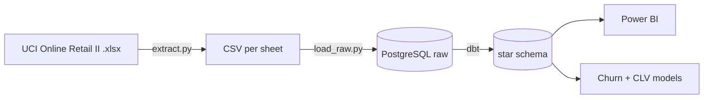
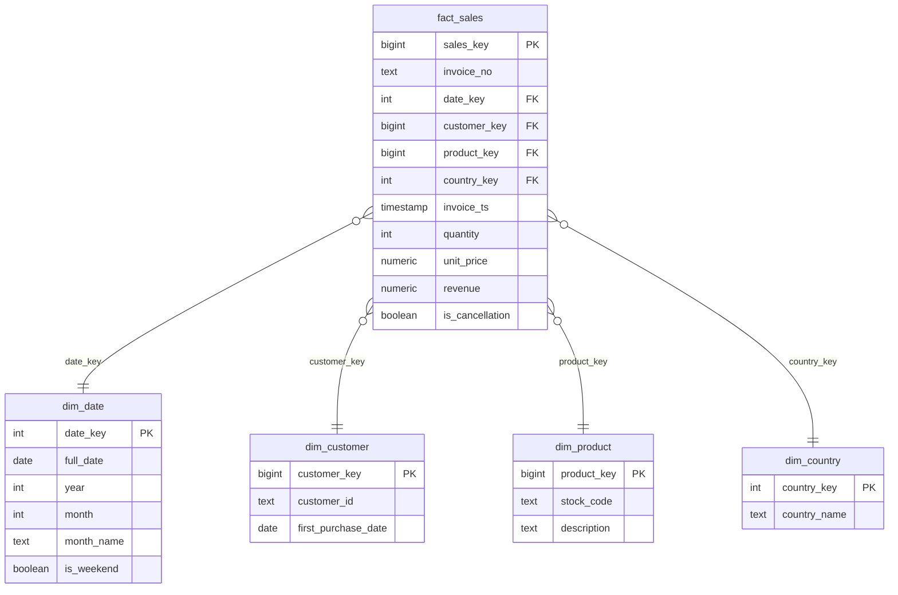
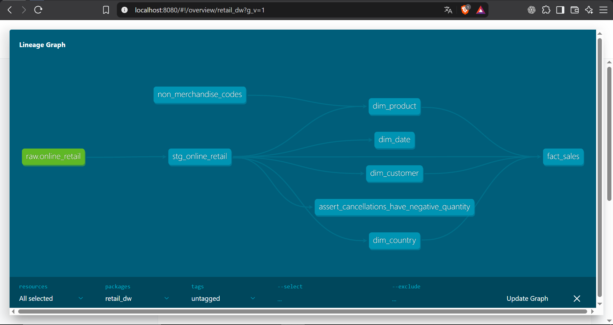

# Retail Data Warehouse + Customer Churn & CLV Prediction

## 1. The problem

An online retailer loses customers without noticing: a customer simply stops ordering. This project predicts which customers are likely to stop buying, estimates how much each customer is worth over the next 6 months (CLV), and explains why. The output is a ranked list that marketing can act on: high-value customers at high risk of leaving.

## 2. Architecture

## 3. Data

Source: [Online Retail II](https://archive.ics.uci.edu/dataset/502/online+retail+ii) (UCI). Transactions of a UK online gift shop, Dec 2009 – Dec 2011.

## 4. Star schema

**Grain:** one row of `fact_sales` = one invoice line (one product on one invoice).

**Key decisions:**
- Price is stored in the fact, because the same product sells at different prices.
- Guest checkouts (no Customer ID) are linked to an "unknown customer" (`customer_key = -1`) so revenue totals stay correct; the churn model excludes them.
- Cancellations stay in the fact with `is_cancellation = true` and negative quantity, so `SUM(revenue)` is net revenue.
- `dim_date` is generated (one row per calendar day), so days without sales still appear.

## Data cleaning (dbt staging)

| Step | Rows removed | Rows left | Why |
|---|---:|---:|---|
| Raw load | – | 1,067,371 | Both Excel sheets, unchanged |
| Exact duplicates | 34,335 | 1,033,036 | 1–9 Dec 2010 appears in both sheets, plus double-scanned lines |
| Bad-debt adjustments (`A…` invoices) | 6 | 1,033,030 | Accounting entries, not sales |
| Price ≤ 0 after rounding to pence | 6,032 | 1,026,998 | Free items and stock corrections; includes 18 lines priced £0.001 |
| Quantity sign wrong | 1 | 1,026,997 | 1 cancellation with positive quantity (found by a dbt test) |
| **Staging total** | | **1,026,997** | |

Guests (no customer ID) and cancellations are **kept and flagged**, not removed.

